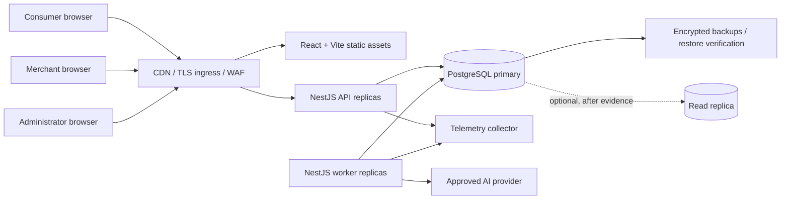

# Thai Chuay Thai Please - System Architecture

Status: baseline proposal

Last updated: 2026-10-06

Scope: prototype defined by `FR-AUTH-01`-`FR-AUTH-06`, `FR-C01`-`FR-C09`, `FR-M01`-`FR-M08`, `FR-S01`-`FR-S06`, and `FR-A01`-`FR-A07` in `docs/REQUIREMENTS.md`

## 1. Architectural goals and constraints

The platform is a production-grade modular monolith built with React, Vite, Tailwind CSS, NestJS, and PostgreSQL. It supports the consumer, merchant POS, administrator, virtual-wallet, quest, point, coupon, and analytics journeys in one deployable product while preserving domain boundaries that can be extracted later if evidence justifies it.

The initial architecture must:

- preserve value-movement correctness under retries, concurrency, delayed jobs, and process restarts;
- keep successful receipts immutable and historically reproducible;
- keep wallet and point balances explainable from immutable ledgers;
- bind each payment to the exact reviewed payment-intent and cart snapshot;
- use the post-discount final amount when evaluating spend-based quests;
- allow AI to propose quests but never approve completion or issue value;
- scale web, API, and worker processes horizontally without process-local authority;
- support Thai as a first-class locale without embedding product copy or policy in components;
- avoid infrastructure whose operational need has not been demonstrated.

Real payment gateways, refunds, external POS integration, multi-receipt quests, and location-aware quests are outside the current prototype. Introducing one requires a new requirement decision and architecture review.

## 2. Context and deployment view



The React application is built once and served as immutable static assets. The NestJS API and worker use the same domain/application packages but different composition roots. Both are stateless; durable workflow state, job leases, idempotency records, and outbox events live in PostgreSQL. A load balancer may route any request to any API replica.

PostgreSQL is the initial system of record. A separate message broker, cache, search service, or analytics warehouse is not part of the baseline. Add one only through an ADR that establishes measured demand, failure handling, ownership, monitoring, and migration/removal strategy.

The deployment supplies secrets and validated environment configuration at runtime. Schema migrations run as a separately controlled release step before compatible application rollout, never through production auto-synchronization. API and worker processes support graceful shutdown; readiness fails when mandatory dependencies are unavailable, while liveness only proves that the process can make progress.

## 3. Repository and runtime boundaries

```text
apps/
  web/        React/Vite presentation and generated API client
  api/        NestJS HTTP composition root
  worker/     NestJS job/outbox composition root
packages/
  contracts/  versioned transport schemas and generated client surface
  config/     shared build, lint, TypeScript, and test configuration
docs/         requirements, decisions, threat models, and runbooks
```

The browser consumes only versioned REST/OpenAPI contracts. It never imports server domain objects, persistence entities, or database types. The API does not serve as a generic database façade: controllers validate input, authorize the actor, call one application use case, and map its result to stable machine-readable error codes.

Within each backend context, use these directional layers:

```text
transport -> application -> domain
                |            ^
                v            |
          infrastructure ----+
```

- `domain`: entities, value objects, policies, events, and ports; no NestJS, HTTP, ORM, or vendor imports.
- `application`: use cases, transaction orchestration, authorization at resource scope, and port interfaces.
- `infrastructure`: PostgreSQL repositories, AI adapter, clock/ID implementations, telemetry, and job adapters.
- `transport`: controllers, request/response schemas, guards, and exception mapping.

Dependencies point inward. Contexts do not import another context's repository or write its tables. Synchronous collaboration uses an explicit application façade; asynchronous collaboration uses versioned domain events. Circular NestJS modules and `forwardRef` are architecture defects to resolve, not defaults.

## 4. Bounded contexts and ownership

| Context                     | Owns                                                                                               | Primary requirements                             | Permitted collaborators                                                                  |
| --------------------------- | -------------------------------------------------------------------------------------------------- | ------------------------------------------------ | ---------------------------------------------------------------------------------------- |
| Identity and Access         | identities, credentials/sessions, roles, actor-tenant relationships                                | `FR-AUTH-01`-`FR-AUTH-06`, `FR-A03`              | exposes authenticated actor and policy decisions; owns no wallet or merchant data        |
| Consumer Profile            | consumer preferences and safe personalization inputs                                               | `FR-C01`, `FR-S01`                               | reads approved transaction features; supplies minimized profile features                 |
| Merchant Catalog            | merchants, products, categories, price lifecycle                                                   | `FR-M01`, `FR-M02`, `FR-A02`                     | POS reads current catalog; receipts store snapshots rather than mutable references alone |
| POS and Pricing             | carts, cart lines, discount calculation, immutable cart/payment snapshot creation                  | `FR-M03`, `FR-M04`, `FR-C09`                     | requests coupon eligibility; creates a pending payment intent through Payment            |
| Payment and Wallet          | payment intents, QR token binding, virtual-money wallet ledger, top-up, debit, payment idempotency | `FR-C02`, `FR-C03`, `FR-C05`, `FR-M05`, `FR-M06` | transactionally coordinates coupon use and receipt creation through application ports    |
| Transaction and Receipt     | successful transaction and immutable receipt snapshots                                             | `FR-C06`, `FR-M08`                               | emits `receipt.created`; never accepts post-success mutation                             |
| Quest                       | AI proposal intake, policy validation, assignment, deterministic evaluation, completion uniqueness | `FR-C07`, `FR-S01`-`FR-S06`                      | consumes receipt facts; requests Point reward issuance                                   |
| Point Ledger                | immutable point earning, spending, expiry, derived balance                                         | `FR-C08`, `FR-S06`, `FR-A06`                     | issues reward once for a quest-completion key; debits for coupon exchange                |
| Coupon                      | coupon issuance, ownership, eligibility, reservation/redemption, expiry                            | `FR-C09`, `FR-M03`, `FR-C05`                     | participates atomically in pricing/payment; never trusts client status                   |
| Analytics and Social Impact | event-driven read models and aggregate metrics                                                     | `FR-M07`, `FR-A01`, `FR-A07`                     | consumes facts; does not write transactional contexts                                    |
| Administration and Policy   | merchant oversight, versioned quest/reward policy, privileged audit                                | `FR-A02`-`FR-A06`                                | publishes policy changes; cannot mutate ledger or receipt history                        |
| Notification (deferred)     | delivery preferences and notification attempts                                                     | not currently required                           | may consume events after explicit approval                                               |

Every table has one owning context. Foreign keys may preserve local-monolith integrity, but cross-context reads still go through an owner-provided query/application contract so a future extraction does not require callers to understand table layout.

## 5. Authoritative data model and transaction boundaries

Money is represented as integer minor units plus an explicit currency code. Point quantities are integers. Timestamps are UTC `timestamptz`; expiry semantics use an explicit half-open interval (`valid_at < expires_at`). Public IDs are globally unique and non-sequential where enumeration would expose sensitive volume.

### 5.1 Value ledgers

Wallet and point entries are append-only facts. Each entry has an account, direction/signed amount, reason code, stable business reference, occurred-at timestamp, and creation metadata. A unique business reference prevents the same top-up, payment debit, quest reward, coupon exchange, or expiry from being applied twice. Balances are derived from ledger entries. If a stored balance projection is introduced for locking or read performance, it is updated in the same transaction and continuously reconciled to the ledger.

See [ADR-0002](adr/0002-ledgers-and-idempotent-value-movement.md).

### 5.2 Payment completion boundary

Payment completion is one short PostgreSQL transaction and is the strongest consistency boundary:

1. authenticate the consumer and authorize ownership of the wallet and coupon;
2. load and lock the pending payment intent, wallet account, and coupon reservation/redemption row in a deterministic order;
3. verify the integrity-protected QR token, intent status, merchant binding, snapshot digest, expiry, and request idempotency key;
4. recompute the authoritative final amount from the stored cart and discount snapshot; never accept totals from the browser;
5. reject insufficient funds without creating a successful receipt or debit entry;
6. insert the wallet debit ledger entry and update any balance projection;
7. atomically consume the eligible single-use coupon, when present;
8. transition the payment intent once and insert the immutable transaction/receipt snapshot;
9. insert `receipt.created.v1` and `payment.completed.v1` outbox records;
10. commit, then return the persisted result associated with the idempotency key.

Uniqueness constraints on the payment intent, wallet debit business reference, coupon use, receipt, and idempotency scope are the final duplicate barrier. A retry returns the original serialized outcome. Conflicting reuse of an idempotency key with a different canonical request hash is rejected.

Quest evaluation and analytics do not extend this lock-holding transaction. They process the committed receipt event asynchronously. The deterministic Quest context evaluates each assignment against that one receipt's immutable categories and final post-discount amount. Completion and point reward issuance use unique `(assignment_id, receipt_id)` and reward business keys so duplicate delivery cannot duplicate points.

### 5.3 Other transaction boundaries

- **Virtual top-up:** idempotency record and wallet ledger credit commit together.
- **Point-to-coupon exchange:** lock point account; insert point debit and owned coupon instance in one transaction.
- **Quest assignment:** validate an AI proposal against the active versioned policy and constrained rule schema; insert the automatically active assignment and outbox event together.
- **Expiry:** claim bounded batches with safe row locking; append expiry ledger entries or transition eligible states idempotently; never rewrite historical entries.
- **Administration:** policy version and security audit event commit together. Published policy versions are immutable.

All constraints are duplicated at the appropriate application and PostgreSQL layers: `NOT NULL`, foreign keys, checks, unique indexes, and immutable-table permissions/triggers where justified by the threat model. Isolation level and lock order are explicit per use case and verified with concurrent integration tests.

## 6. Events, outbox, and background jobs

An outbox row is inserted in the same transaction as its domain fact. It contains an event ID, stable type and schema version, aggregate ID/version, causation/correlation IDs, occurred-at time, payload, and publish state. A worker claims bounded batches using PostgreSQL row locking with skip-locked semantics, publishes to an internal handler registry in the baseline, and records success or a bounded retry schedule.

Handlers maintain an inbox/processed-event key and are idempotent. They tolerate duplicate, delayed, and reordered delivery and reject unsupported schema versions visibly. Failed items move to an explicit dead-letter state after configured bounded retries; operators can inspect and replay them using a runbook. Business handlers never mark success after a partial write.

Initial background workloads include:

- quest proposal generation and policy validation;
- receipt-driven quest evaluation and point reward issuance;
- quest, point, and coupon expiry;
- analytics read-model projection;
- wallet/point and cross-record reconciliation;
- outbox delivery and dead-letter replay.

Job names, schedules, retry limits, leases, and timeouts are validated configuration, not source-level policy literals. PostgreSQL-backed jobs are adequate initially; adopt a broker only after throughput, latency, or isolation evidence exceeds this design.

## 7. AI boundary

The AI adapter receives minimized/pseudonymized behavioral features rather than raw personal or payment data wherever possible. Its output is parsed as untrusted input against a versioned allow-listed schema. Allowed quest rules are declarative operands such as eligible merchant/category, minimum final amount, reward points, and expiry; arbitrary code, SQL, templates, and URLs are forbidden.

Administration owns versioned policy bounds for eligibility, reward budget, frequency, duplication, duration, and allowed rule forms. The Quest context either accepts a compliant proposal or records a safe rejection/fallback. The deterministic rule engine alone decides completion from immutable receipt facts. The Point context alone issues a reward. Prompt, model/configuration, feature version, rule schema, and policy version are retained to explain assignments without treating model output as authority.

## 8. API, frontend, and authorization

The API is versioned under a single contract owner and OpenAPI is generated from source. Requests reject unknown fields where feasible and errors expose stable codes without stack, SQL, or infrastructure details. Value-moving mutations require scoped idempotency keys. Cursor pagination is used for growing histories.

Authentication is centralized, but every application use case also enforces actor, role, tenant/merchant association, and resource ownership. Authorization is deny-by-default. Consumer, merchant, and administrator views are projections, never authorization inputs. Cookie-based sessions require `HttpOnly`, `Secure`, suitable `SameSite`, CSRF protection on mutations, rotation, expiry, logout, and revocation; exact authentication mechanics require a threat-model decision before implementation.

The React application separates generated remote-state contracts from local UI state. It defines loading, empty, stale, error, success, and permission-denied states for each surface; disables accidental duplicate submission while still relying on server idempotency; localizes all user-visible copy; and treats merchant, QR, AI, and translated content as untrusted. Tailwind semantic tokens and accessible primitives target WCAG 2.2 AA.

QR payloads contain an opaque, high-entropy, short-lived, integrity-protected reference - not prices, wallet authority, or trusted cart contents. The server binds the token to the payment intent, merchant, snapshot digest, status, and expiry, and revalidates all facts before payment.

## 9. Security and privacy controls

- TLS at every network boundary, strict CORS allow-list, CSP and output encoding, parameterized queries, and risk-based rate limiting.
- Secrets supplied outside source control, validated on startup, rotated, and redacted from telemetry.
- Least-privilege database roles separate migration, API, worker, and read-only operational access.
- PII minimization and purpose-specific retention; analytics uses pseudonymous identifiers and least-granular facts needed for approved metrics.
- Security audit events record actor, action, target, result, time, correlation ID, and safe before/after metadata for privileged changes and value movement.
- QR replay, cross-account access, role escalation, expired-resource use, request tampering, and concurrent duplicate operations are mandatory negative tests.
- Dependency, container, secret, static-analysis, and license checks gate release; no compliance certification is implied.

A dedicated threat model must be completed before authentication or payment implementation. It must cover trust boundaries, credential/session lifecycle, QR theft/replay, idempotency abuse, privilege escalation, AI data disclosure, ledger tampering, and operational access.

## 10. Scalability and reliability

Scale API and worker replicas independently. Work claims and uniqueness live in PostgreSQL, so replica count does not affect correctness. Keep requests bounded, paginate histories, eliminate N+1 access, and index verified foreign-key and query paths. Slow AI and analytics work remains outside request latency.

No numeric service-level objective or capacity claim is invented from the report. Before production launch, establish measured load profiles and approved objectives for API availability/latency, payment confirmation, job lag, recovery point, and recovery time. Load tests then become release evidence.

Evolution follows measured pressure:

1. **Baseline:** modular monolith, one PostgreSQL primary, PostgreSQL outbox/jobs, immutable static web assets.
2. **Read scaling:** add projections, pre-aggregation, or a read replica when dashboards measurably affect transactional load; never use a lagging replica for value authorization.
3. **Job isolation:** introduce a broker when PostgreSQL polling cannot meet approved lag/throughput or isolation objectives; retain outbox and consumer idempotency.
4. **Data lifecycle:** partition/archive large ledgers and events only after growth/query evidence and tested restore procedures.
5. **Service extraction:** extract a bounded context only when independent scaling, fault isolation, release ownership, or regulatory separation provides measurable value. Define API/event contracts, data ownership, consistency changes, migration, rollback, and operations in a new ADR.

See [ADR-0001](adr/0001-modular-monolith.md).

## 11. Observability and operations

All entry points propagate a correlation ID; events also carry causation IDs. Structured logs use stable event names and safe identifiers, never credentials, session tokens, raw QR tokens, or unnecessary personal data. OpenTelemetry-compatible traces connect HTTP, database, outbox, jobs, and AI adapter spans. Metrics use low-cardinality labels.

Minimum operational views cover:

- request rate, latency, errors, saturation, and authorization denials;
- payment outcomes, insufficient-fund rejections, idempotency conflicts, and duplicate-prevention violations;
- wallet/point reconciliation discrepancies and ledger-projection drift;
- coupon contention, invalid/expired use, and duplicate redemption attempts;
- quest proposal schema/policy rejection, evaluation lag, completion, and reward issuance;
- outbox/job lag, retry/dead-letter counts, worker lease age, and PostgreSQL health;
- merchant sales and social-impact projection freshness, clearly distinguished from authoritative facts.

Alerts target user-visible failures and invariant violations. Reconciliation jobs report discrepancies and never silently rewrite history. Runbooks cover payment ambiguity, reconciliation failures, outbox backlog, dead-letter replay, database saturation, compromised QR/session response, migration recovery, backup restore, and AI-provider failure.

## 12. Verification strategy

| Layer                  | Required evidence                                                                                                                                                |
| ---------------------- | ---------------------------------------------------------------------------------------------------------------------------------------------------------------- |
| Domain unit            | money/point value objects, discount order, quest rules using one receipt and final amount, state transitions, expiry boundaries                                  |
| PostgreSQL integration | constraints, migrations, ledger reconciliation, lock order, insufficient funds, concurrent debit/redemption/reward, idempotent outbox/inbox                      |
| Contract               | OpenAPI schemas, stable error codes, rejected unknown input, authorization expectations, generated-client drift                                                  |
| End to end             | login and ownership, top-up/history, cart-to-QR, review/pay, retry, insufficient funds, immutable receipt, quest/reward, point-to-coupon, coupon use, dashboards |
| Security               | cross-account/merchant access, role escalation, QR tamper/replay/expiry, CSRF, injection, rate limit, sensitive-data leakage                                     |
| Operations             | migration on empty/upgraded databases, graceful shutdown, job recovery, reconciliation alert, backup restore, representative load profile                        |

Deterministic clocks, IDs, and randomness make expiry and idempotency tests reproducible. Tests claiming transactional safety run against real PostgreSQL-compatible infrastructure, not mocked repositories.

## 13. Requirement coverage and unresolved decisions

| Capability                         | Requirements                                    | Architecture owner                       |
| ---------------------------------- | ----------------------------------------------- | ---------------------------------------- |
| Consumer overview, wallet, history | `FR-C01`-`FR-C03`, `FR-C06`, `FR-C08`, `FR-M06` | Identity, Payment/Wallet, Receipt, Point |
| Scan, review, pay                  | `FR-C04`, `FR-C05`, `FR-M04`, `FR-M05`          | POS/Pricing, Payment/Wallet, Receipt     |
| Products, carts, discounts         | `FR-M02`-`FR-M04`, `FR-C09`                     | Merchant Catalog, POS/Pricing, Coupon    |
| Quests and rewards                 | `FR-C07`-`FR-C09`, `FR-S01`-`FR-S06`            | Quest, Point, Coupon                     |
| Dashboards and policy              | `FR-M07`, `FR-A01`-`FR-A07`                     | Analytics, Administration/Policy         |

These product decisions remain intentionally open and must not be hardcoded:

- authentication/account-recovery method and exact role/merchant membership model;
- currency, money scale, virtual top-up authorization and limits;
- coupon combination/priority rules and reservation lifetime;
- quest/reward policy limits, point-expiry accounting order, and policy effective dates;
- payment-intent/QR expiry, retry windows, retention periods, and user timezone behavior;
- approved AI provider, data residency/retention, fallback policy, and reward budget;
- deployment environment, availability/latency objectives, RPO/RTO, and capacity profile.

Resolve each through requirements and, where architectural, an ADR before implementing the affected production path.
